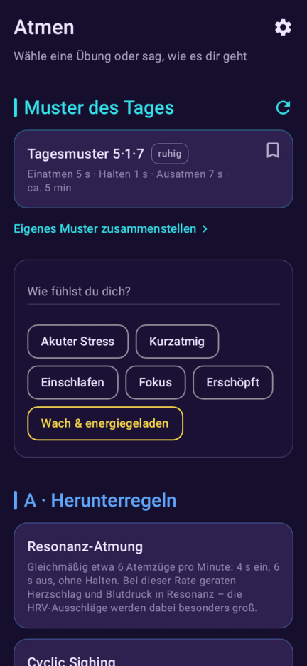
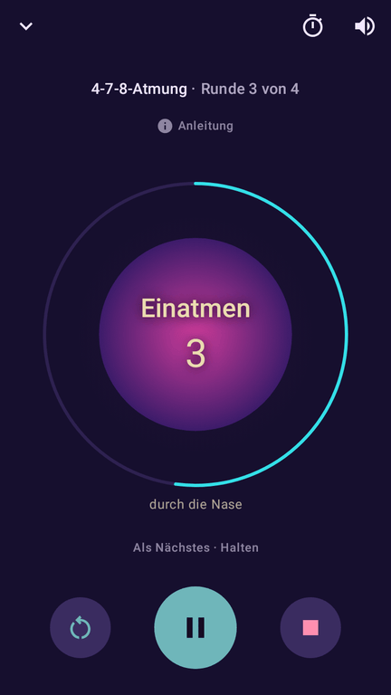

# Atemkraft

Android-App für Atemübungen und stille Meditation. Ein mitatmender Kreis, Töne und Vibration führen dich durch 20 Atemtechniken; zu jeder steht, was die Studienlage hergibt, mit Quellen und Sicherheitshinweisen.

Ohne Konto, ohne Werbung, ohne Tracking; offline bis auf den optionalen Download einer Sprachstimme. Atemkraft ist eine Wellness-App und kein Medizinprodukt; sie ersetzt keinen Rat von Ärztin, Arzt oder anderem Fachpersonal.

<p>
  
  
</p>

## Funktionen

Beschrieben ist der Stand von `main`; die neueste APK unter Releases kann Einzelnes davon noch nicht haben.

- **Atmen:** 17 Übungen in vier Gruppen, je mit Anleitung, Studienlage, Sicherheitshinweisen und Quellen. Zeiten lassen sich pro Übung anpassen. Darüber „Wie fühlst du dich?“: Anlässe wie „Einschlafen“ zum Antippen und eine Suche nach deinem Befinden.
- **Sitzung:** Der Kreis wächst beim Einatmen und schrumpft beim Ausatmen, dazu Töne und Vibration. Am Ende eine kurze Bilanz.
- **Muster des Tages:** jeden Tag ein neues, ruhiges oder sanft aktivierendes Muster zum Ausprobieren und Speichern.
- **Eigene Kreationen:** einen Atemzug frei aus Einatmen, Halten und Ausatmen zusammenstellen, mit Atemkurve, Vorlagen und Vorschau, gesammelt im Tab „Eigene“, zusammen mit den Übungen, die du mit „Tut mir gut“ markiert hast, und dem Verlauf deiner Sitzungen.
- **Meditation:** Timer mit Zeitring, Gong und optional gesprochener Anleitung; läuft bei ausgeschaltetem Bildschirm weiter. Auf Wunsch geht eine Atemübung nahtlos in die stille Meditation über.
- **Lernen:** Atemlehre (etwa die fünf vāyus), Pranayama mit Grundlagen und Techniken wie Ujjayi, jeweils mit Übung zum Ausprobieren, Begriffe erklärt und Programme wie Buteyko und Nasenatmung zum Nachlesen.
- **Logbuch und Export:** abgeschlossene Sitzungen, gespeicherte Muster als Datei sichern.

## Installieren

Atemkraft gibt es als APK auf GitHub, nicht im Play Store (Android 8.0 oder neuer).

1. Auf dem Handy [Neueste Version](https://github.com/grenzenloseSchublade/atemkraft/releases/latest) öffnen und unter „Assets“ `atemkraft-vX.Y.Z.apk` laden.
2. Die Datei öffnen und dem Browser einmal erlauben, Apps zu installieren.
3. „Installieren“ tippen. Updates genauso darüber installieren; Logbuch, Muster und Einstellungen bleiben.

Echte APKs tragen dieses Zertifikat (SHA-256), prüfbar mit [AppVerifier](https://github.com/soupslurpr/AppVerifier) oder `apksigner verify --print-certs`:

```
75:02:2D:EF:E6:5A:A2:4E:22:3F:3E:79:88:0F:09:F4:23:45:67:57:00:2F:F0:B3:3B:A2:AE:29:B9:F4:18:90
```

Mehr dazu in [docs/SECURITY.md](docs/SECURITY.md#echtheit-einer-apk-prüfen).

## Datenschutz

Atemkraft erhebt keine Daten über dich. Logbuch, Muster und Einstellungen bleiben auf deinem Gerät, auch ohne Cloud-Backup. Die einzige Netzverbindung: Tippst du bei einer Sprachstimme auf „Laden“, holt die App sie von GitHub ([sherpa-onnx](https://github.com/k2-fsa/sherpa-onnx)); GitHub sieht dabei deine IP-Adresse.

Einzelheiten und Berechtigungen: [Datenschutzerklärung](docs/PRIVACY.md).

## Mitmachen

Fehler oder Idee? [Issue eröffnen](https://github.com/grenzenloseSchublade/atemkraft/issues/new/choose), bitte ohne Gesundheitsdaten. Sicherheitslücken vertraulich melden: [docs/SECURITY.md](docs/SECURITY.md#melden).

Bauen braucht JDK 17 und das Android SDK (Plattform 37):

```bash
scripts/build.sh installDebug    # Debug-APK bauen und installieren
scripts/check.sh                 # alle Prüfungen wie im CI
```

Alles Weitere in [CONTRIBUTING.md](CONTRIBUTING.md), [Styleguide](docs/STYLEGUIDE.md) und [Verhaltenskodex](CODE_OF_CONDUCT.md). Änderungen je Version: [docs/release-notes](docs/release-notes).

## Lizenz

Quellcode unter der [MIT-Lizenz](LICENSE). Die APK enthält zusätzlich eSpeak NG (GPL-3.0-or-later), daher gilt für ihre Weitergabe als Ganzes die GPL-3.0. Ladbare Stimmen haben eigene Lizenzen, manche nur nicht kommerziell. Alles Weitere: [THIRD_PARTY_LICENSES.md](THIRD_PARTY_LICENSES.md), keine Rechtsberatung.
